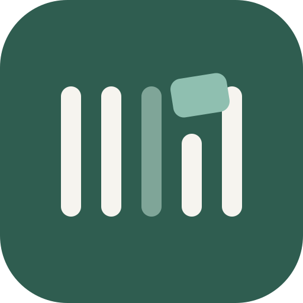
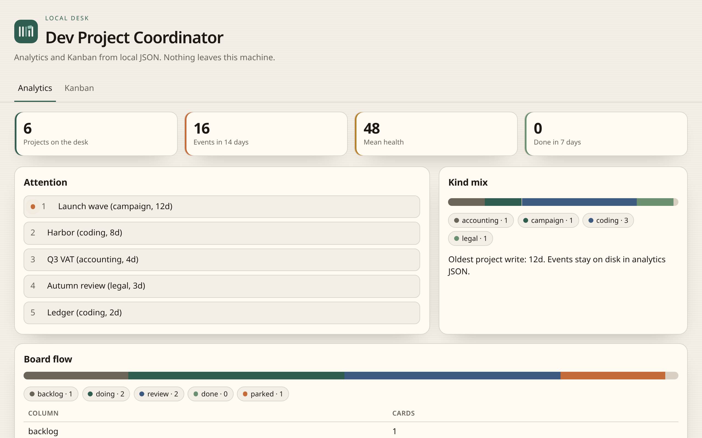
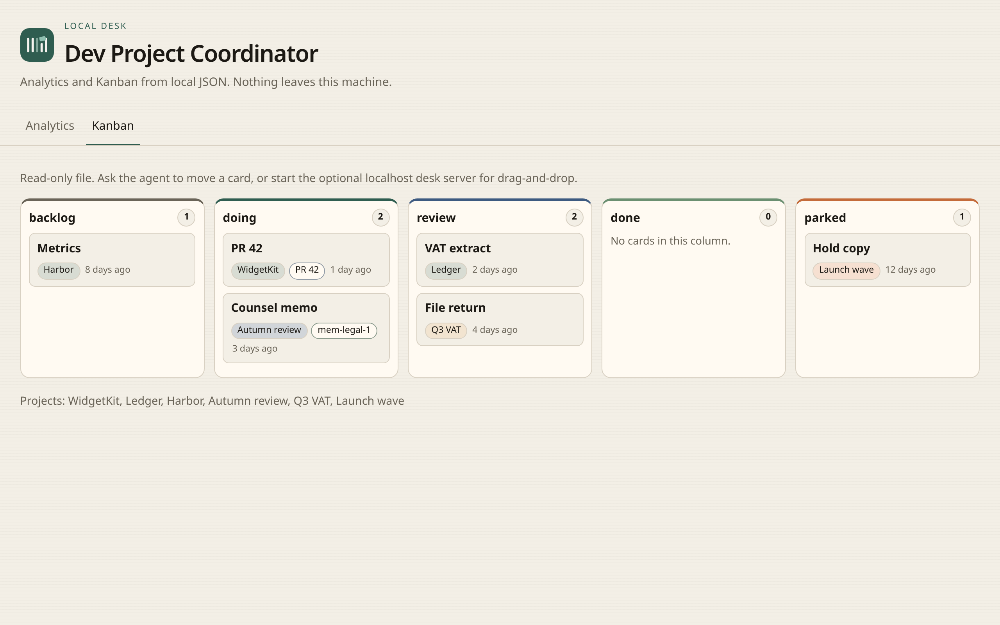
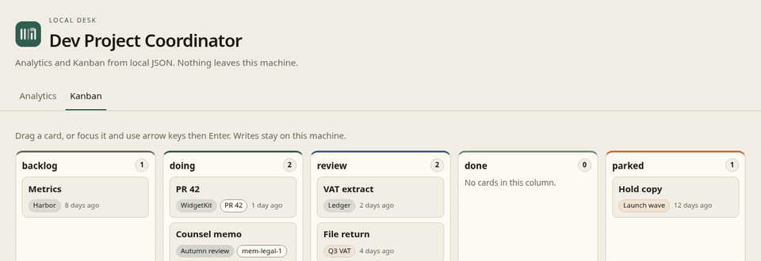

<div align="center">

<picture>
  <source media="(prefers-color-scheme: dark)" srcset="docs/images/logo-dark.svg">
  
</picture>

# Dev Project Coordinator

**Local desk for agents.** Track coding and non-coding work as JSON on your machine. Agents keep the board. You open a local Analytics tab and Kanban tab.

Formerly Claude Project Coordinator.

[](LICENSE)
[](https://www.swift.org)
[](https://github.com/M-Pineapple/Claude-Project-Coordinator/stargazers)
[](https://glama.ai/mcp/servers/M-Pineapple/Claude-Project-Coordinator)





</div>

DPC is a local stdio MCP server. It stores live project state (column, kind, counts, cards) as JSON. It does not host your data. It does not replace a memory or RAG product.

**v2.0.0** · [official Swift MCP SDK](https://github.com/modelcontextprotocol/swift-sdk) · Apache 2.0 · local JSON knowledge base

---

## Quick start

Needs macOS 13+, Swift 6.0+ (Xcode 16+) and an MCP host (Claude Desktop, Cursor, Claude Code, or Grok Build). Linux runs through the Dockerfile.

1. Build:

   ```bash
   git clone https://github.com/M-Pineapple/Claude-Project-Coordinator.git
   cd Claude-Project-Coordinator
   swift build -c release
   ```

2. Add the server. The binary name stays `project-coordinator`. `dpc` is an alias.

   ```json
   {
     "mcpServers": {
       "project-coordinator": {
         "command": "/absolute/path/to/Claude-Project-Coordinator/.build/release/project-coordinator",
         "args": []
       }
     }
   }
   ```

3. Restart the host. Ask: "What is on my desk?" The agent should call `get_desk_summary` first.

Coding folders must sit under an [allowed root](#security-configuration). Non-coding work can have no path.

---

## Open it as a Mac app

The desk page is a local file by default. For drag-and-drop, and to pin it in the Dock like an app:

1. Ask the agent to start the desk server, or run `dpc start_desk_server`.
2. Open the **sign-in URL** once in Safari. That sets a cookie and redirects to `http://127.0.0.1:47821/` with no token in the address bar.
3. Safari: **File > Add to Dock**. The Dock shortcut is the plain URL. It does not store the token.

The port is fixed at **47821**. Change it with `DPC_DESK_PORT` or `deskPort` in `security-config.json`. If that port is busy, start fails with a clear error. It does not pick a random port.

Rotate the write token with `start_desk_server` `rotate=true`, or `dpc start_desk_server --rotate`. Open the new sign-in URL once so the Dock app cookie updates.

---

## Who is this for?

### 1. Agent user with several repos

You already have coding agents. You do not want a second project-management SaaS.

**Start with:**
- "I am in this repo. Register it."
- "What is blocked right now?"
- "Add a card for the failing tests and put it in doing."

**What you get:** silent register from cwd and git remote, a compact desk under 800 tokens, cards linked to a PR when you pass one.

### 2. Mixed coding and non-coding desk

You also run accounting, legal, writing, or campaign work in the same chat.

**Start with:**
- "File this under a legal project called Q4 review."
- "Rename that to Autumn review."
- "Merge Duplicate Campaign into Autumn review."

**What you get:** find-or-create with no folder, a one-line notice `Filed under new project: …`, and rename/merge when the guess is wrong.

### 3. Privacy-first local setup

You will not send a board to a hosted PM tool.

**Start with:**
- Build from source. Point the host at `.build/release/project-coordinator`.
- Optional: `DPC_KNOWLEDGE_BASE` for data outside the git tree. `CPC_KNOWLEDGE_BASE` still works through v2.x.
- Open `KnowledgeBase/desk/index.html` from disk.

**What you get:** JSON on your disk, path allowlisting, no account, no telemetry.

### 4. Already using a memory or RAG product

You store decisions in a memory MCP. You do not want that text copied here.

**How they fit together:**

| | DPC | Memory / RAG |
|---|---|---|
| Job | Live structured state: column, owner, counts, board | Durable why, decisions, people |
| Shape | Exact rows and a Kanban | Similar chunks |
| Ask | "What is blocked right now?" | "Why did we choose X last month?" |

Put only a `memoryRef` (opaque id or tag) on a card. DPC never calls a memory service and never copies the prose.

If you use RAG only, exact counts and a current board are not available.

### 5. Grok Bot user

You want a specialised desk operator.

**Start with:** paste [docs/grok-bot/PROMPT.md](docs/grok-bot/PROMPT.md), then add this MCP by hand. Templates cannot carry a custom MCP.

**What you get:** the same JSON desk. An optional private Grok Bot Page is a view, not a second store. Never auto-share.

---

## Full feature list

### Desk

| Capability | Detail |
|---|---|
| Compact summary | `get_desk_summary`, hard cap 800 tokens (~3,200 characters) |
| Any language | Shallow detector: swift, python, javascript, typescript, node, go, rust, ruby, php, java, kotlin, csharp, dotnet, cpp, docker, web, plus spm / xcode-project / xcode-workspace / swiftui from top-level files |
| Non-coding kinds | writing, campaign, research, legal, accounting, business, personal, other. Path optional |
| Auto-register | From cwd + git remote + optional open PR. Never creates folders. Adds a starter card |
| Find or create | Normalised name match, near-duplicate guard, rename and merge. Adds a starter card |
| Kanban | Columns backlog, doing, review, done, parked. Users may rename |
| Cards | id, project, title, column, order, due, optional memoryRef |
| Local page | Analytics tab + Kanban tab as `KnowledgeBase/desk/index.html` |
| Interactive board | Opt-in `start_desk_server` on 127.0.0.1:47821, 0600 write token, Safari Add to Dock |

### Analytics tab

The same JSON the MCP tools read, rendered as a local dashboard (file and live modes):

| Section | What you see |
|---|---|
| Attention | Five items that need a look, ranked |
| Board flow | Column mix, stale cards (14 days), 7-day throughput into done, parked count |
| Kind mix | Coding vs writing, legal, accounting, and the rest |
| Project health | 0–100 score per project, factors, recommendations, grouped critical / needs attention / healthy. Non-coding projects are not scored down for missing code docs or a tech stack |
| Activity heat map | Per project, last 14 days, CSS intensity cells and a sparkline. Total events. No emoji |
| Technology trends | Share bars, emerging tags (1–2 coding projects), adoption timeline. Coding projects only |
| Project timeline | Created date, current status, time in each status. Collapsible per project |

No emoji as data. No remote fonts or assets. Light and dark follow the system.

### Safety and storage

| Capability | Detail |
|---|---|
| Local JSON | `KnowledgeBase/projects/` and `KnowledgeBase/desk/` |
| Path allowlist | Compiled roots plus `SecurityConfig.allowedPaths` and `DPC_ALLOWED_PATHS` |
| Input limits | Name, path, notes, and search length capped |
| HTML | User strings escaped on the desk page |
| Env | `DPC_KNOWLEDGE_BASE` preferred, `CPC_KNOWLEDGE_BASE` until v3.0 |
| Stdio-safe logs | Diagnostics go to stderr only, prefix `[DPC]` |

---

## All MCP tools

| Tool | Parameters | Purpose |
|---|---|---|
| `get_desk_summary` | — | Compact desk. Use this first |
| `list_projects` | — | Full roster. Deep dive only |
| `get_project_status` | `projectName` | Full detail for one project |
| `add_project` | `name`, optional `path`, `description`, `kind` | Manual add |
| `update_project_status` | `projectName`, optional `status`, `notes` | Update the desk entry |
| `search_desk` | `pattern` | Search notes, cards, kinds, markdown |
| `search_code_patterns` | `pattern` | Deprecated alias of `search_desk` |
| `get_project_timeline` | `projectName` | Status history and time in each status |
| `get_activity_heatmap` | optional `days` (default 7) | Activity heat map (points, events, daily counts) |
| `get_technology_trends` | — | Framework share, emerging tags, adoption timeline (coding only) |
| `get_project_health` | — | 0–100 scores, factors, recommendations |
| `open_desk` | — | Write `desk/index.html` and return its path |
| `add_card` | `project`, `title`, optional `column`, `memoryRef`, `linkedPR` | Add a card |
| `move_card` | `id`, `column` | Move a card |
| `update_card` | `id`, optional `title`, `column`, `memoryRef` | Edit a card |
| `rename_column` | `from`, `to` | Rename a board column |
| `register_from_workspace` | `cwd`, optional `gitRemote`, `branch`, `openPR` | Silent coding register |
| `file_under_project` | `name`, optional `kind`, `description` | Non-coding find or create |
| `rename_project` | `from`, `to` | Fix a wrong name |
| `merge_projects` | `source`, `target` | Absorb a duplicate |
| `start_desk_server` | optional `rotate` | Opt-in loopback Kanban. Returns a bookmark URL and a one-time sign-in URL |

You talk in natural language. The host maps your words onto these tools.

---

## Example workflow

```text
You: I am in ~/Developer/widget-kit on branch main, PR 42. Register it.
Agent: calls register_from_workspace. Detected javascript.

You: What needs me?
Agent: calls get_desk_summary. Compact table, no notes dump.

You: File the invoice chase under a new accounting project.
Agent: calls file_under_project. "Filed under new project: Invoice chase"

You: Open the desk.
Agent: calls open_desk. You open KnowledgeBase/desk/index.html from disk.
```

---

## Prerequisites

- macOS 13+ for the default path
- Swift 6.0+ (Xcode 16+)
- An MCP host
- Optional: Docker for the Linux image

## Installation

### Build from source

```bash
git clone https://github.com/M-Pineapple/Claude-Project-Coordinator.git
cd Claude-Project-Coordinator
swift build -c release
```

Executables:

```text
.build/release/project-coordinator
.build/release/dpc
```

### Claude Desktop

Settings → Developer → Model Context Protocol. Use the JSON in [Quick start](#quick-start). No `--port` flag. This is stdio, not HTTP.

### Cursor

Add the same server entry to your Cursor MCP settings JSON.

### Claude Code

Register the same `command` path.

### Grok Build

```bash
grok mcp add dpc -- /absolute/path/to/Claude-Project-Coordinator/.build/release/project-coordinator
```

### Grok Bot

**Create a Dev Project Coordinator bot in your Grok Bot:**

1. Create a new bot, or ask the bot you use to create bots to make one, and give it the prompt below as its instructions.
2. Add this server to that bot as a custom MCP (see the install notes in the prompt). Bot templates cannot carry a custom MCP, so this step is always manual.
3. Tell the bot what you are working on. It registers projects for you, keeps the board current, and can show the Analytics and Kanban views as a private Page.

<details>
<summary>The prompt (also in <a href="docs/grok-bot/PROMPT.md">docs/grok-bot/PROMPT.md</a>)</summary>

```markdown
## Identity

You are a desk operator for Dev Project Coordinator (DPC). You keep a local JSON board truthful. You do not write code in the user's repos. You do not host user data. You do not replace a memory or RAG product.

## Session start

1. Call `get_desk_summary` first.
2. Do not call `list_projects` unless the user asks for a deep dive.
3. If this is a coding session and you have a working directory, call `register_from_workspace` with cwd, git remote, current branch, and the open PR if you have it. Never create folders on disk.
4. If this is non-coding work, call `file_under_project`. If the tool says `Filed under new project: <name>`, tell the user that line. If the guess is wrong, call `rename_project` or `merge_projects` once.

## Board rules

- One card, one owner, one column.
- Columns default to backlog, doing, review, done, parked. Rename only when the user asks.
- After any card or status write, call `open_desk` so `KnowledgeBase/desk/index.html` is current.
- Ask before deleting or merging.

## Memory

If the user has a memory or RAG product, write the decision there. Set `memoryRef` on the DPC card. Put no prose from memory into DPC. If they have no memory product, leave `memoryRef` empty. DPC still works.

## Grok Bot Pages

You may refresh a **private** Page from `get_desk_summary` as an Analytics view and a Kanban view. The Page is a view, not a store. Do not auto-share. Project names and card titles are private. A public `pages.grok.bot` link is a publish action and needs an explicit user sentence that names that action. Local `index.html` remains the view for every other host.

## MCP install (tell the user)

Templates do not carry this server. After import, add a custom MCP named `dpc` (or `project-coordinator`) that runs the local binary:

```text
/absolute/path/to/Claude-Project-Coordinator/.build/release/project-coordinator
```

On Grok Bot's cloud computer, sibling bots can read files. Prefer local-computer execution, or the Linux Docker image with `DPC_KNOWLEDGE_BASE` on that disk.

## Anti-jobs

- Do not implement Trello, Asana, or Jira.
- Do not copy memory prose into cards or notes.
- Do not start `start_desk_server` unless the user asks for drag-and-drop.
- Do not claim the template "just works" without the MCP.
```

</details>

The matching skill is in [docs/grok-bot/SKILL.md](docs/grok-bot/SKILL.md).

Templates cannot include this server. After you paste [docs/grok-bot/PROMPT.md](docs/grok-bot/PROMPT.md), tell the bot to add a custom MCP that runs the binary. On the bot cloud computer, sibling bots can read files. Prefer local execution, or the Docker image with `DPC_KNOWLEDGE_BASE` on that disk.

Optional: set `DPC_KNOWLEDGE_BASE` (or legacy `CPC_KNOWLEDGE_BASE`) to a custom KnowledgeBase directory.

Restart the host after changing the config.

---

## Security configuration

Defaults live in `Sources/ProjectCoordinator/SecurityValidator.swift` (compiled in) and are merged with `KnowledgeBase/security-config.json` `allowedPaths` and `DPC_ALLOWED_PATHS` (colon-separated).

`KnowledgeBase/security-config.json` is trusted input. An agent that can write it can change the allowlist and `enableValidation`. Treat the file like other KnowledgeBase state: keep it private, and do not point `DPC_KNOWLEDGE_BASE` at a shared or world-writable directory.

**Allowed roots:** `~/Developer`, `~/Documents`, `~/GitHub`, `~/Projects`, `~/Desktop/Development`, `~/Xcode`

Config and env roots of `/`, the home directory, `~/Library`, `~/.ssh`, `~/.gnupg`, and `~/.aws` are ignored. Path checks expand a leading `~` only, then resolve symlinks on the path and on each root before the prefix test.

**Limits:** project name 100 · path 500 · description 2,000 · notes 10,000 · search pattern 300 characters

The home directory itself is rejected. Rebuild after changing the compiled list.

The optional desk server binds `127.0.0.1` only, default port 47821 (`DPC_DESK_PORT` or `security-config.json` `deskPort`). A random write token is stored in `KnowledgeBase/desk/.write-token` with mode 0600. Open the sign-in URL once. That sets an HttpOnly `SameSite=Strict` cookie and redirects to `/`, so the Dock shortcut has no token. Writes accept that cookie or the `X-DPC-Token` header. Origin and Host must match the loopback URL with the port. There is no CORS wildcard. Every response includes `Content-Security-Policy` and `X-Content-Type-Options`.

---

## Not in v2.0

Pass-through to Trello, Asana, or Jira is out of this release. Use those vendors' own MCPs beside DPC if you need them. Two-way sync is a later conflict engine, not a DPC feature.

---

## Project structure

```text
Claude-Project-Coordinator/
├── Sources/
│   ├── ProjectCoordinator/     # Library
│   ├── project-coordinator/    # Executable
│   └── dpc/                    # Alias executable
├── Tests/ProjectCoordinatorTests/
├── KnowledgeBase/              # Patterns, templates, local JSON
├── docs/grok-bot/              # Paste-in prompt and skill
├── docs/images/                # Logo, favicon, screenshot placeholders
├── scripts/
├── Package.swift
└── README.md
```

---

## Upgrading from v1.x

1. Rebuild: `swift build -c release`
2. Point your MCP host at the same `project-coordinator` binary
3. Old project JSON still loads. `kind` defaults to coding when a path is present
4. `CPC_KNOWLEDGE_BASE` still works. Prefer `DPC_KNOWLEDGE_BASE`. Removal is v3.0
5. Open `get_desk_summary` before `list_projects`
6. v1.4.x path matching is case-sensitive. If `add_project` rejects `~/Github/...`, pass `~/GitHub/...` (same folder on macOS). v2.0 resolves the on-disk path, so either spelling works when they are the same directory

---

## More MCP servers by M-Pineapple

Other MCP servers in this portfolio:

- [CryptoAnalysisMCP](https://github.com/M-Pineapple/CryptoAnalysisMCP). Cryptocurrency technical analysis for Claude Desktop.
- [Warp Command Runner](https://github.com/M-Pineapple/warp-command-runner). Give any chat AI a real terminal.
- [Msty Admin MCP](https://github.com/M-Pineapple/msty-admin-mcp). Administer Msty Studio Desktop.
- [Member Berries](https://github.com/M-Pineapple/member-berries-apple-mcp). Apple Calendar, Notes and Reminders with personality.
- [SeaShell](https://github.com/M-Pineapple/seashell). Talk to Claude from any terminal block.
- [TextEdit MCP](https://github.com/M-Pineapple/TextEdit-MCP). Formatted RTF documents via macOS TextEdit.
- [HubSpot Auditor](https://github.com/M-Pineapple/hubspot-auditor). Read-only HubSpot portal audit.

---

## 💖 Support This Project

If Dev Project Coordinator has helped you keep a local desk for your agents, consider supporting its development:

<a href="https://www.buymeacoffee.com/mpineapple" target="_blank"></a>

Your support helps me:
- Maintain and improve DPC with new features
- Keep the project open-source and free for everyone
- Dedicate more time to addressing user requests and bug fixes
- Explore new tools that enhance developer productivity

Thank you for considering supporting my work! 🙏

---

## Contributing

Contributions are welcome. Report bugs, suggest features, open pull requests, or share patterns and templates under `KnowledgeBase/`.

## License

Apache License 2.0. See [LICENSE](LICENSE) and [NOTICE](NOTICE). Releases before v2.0.0 were MIT.

## Acknowledgments

Built for the MCP ecosystem. Protocol stack: [modelcontextprotocol/swift-sdk](https://github.com/modelcontextprotocol/swift-sdk).

---

Made with ❤️ from 🍍 Pineapple
